# Polli-Run — Tutorial: cómo se juega

> Versión visual de este tutorial: abrí **`tutorial.html`** (doble clic, Chrome o Edge).
> Ahí también va a ir el video de cómo se juega.

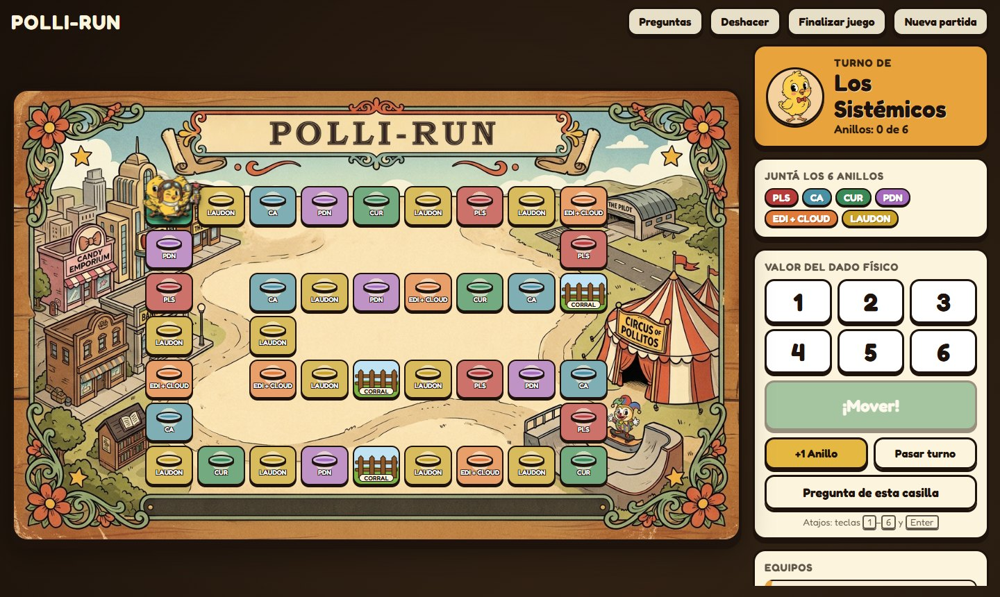

---

## 1. ¿Quién hace qué?

Polli-Run es una carrera de preguntas por equipos. Se juega con la computadora proyectada
y un **dado físico** de verdad.

| Los alumnos (equipos) | Los game masters (profes) |
|---|---|
| Tiran el **dado físico**. | Manejan la computadora y el **panel de control**. |
| Eligen si quieren pregunta **Fácil** o **Difícil**. | Cargan el número del dado y mueven la ficha. |
| Responden la pregunta (dicen la letra: A, B, C o D). | Tocan la opción que eligió el equipo. |
| Piden **comodines** si les sirven. | Activan los comodines, dan anillos a mano, deshacen errores. |

Los alumnos **nunca tocan la computadora**: todo lo que pasa en pantalla lo hace el game master.

---

## 2. El objetivo: juntar los 6 anillos

Hay un anillo por cada temática de la materia. Cada uno tiene su color:

| Temática | Color |
|---|---|
| **PLS** | rojo |
| **CA** | celeste |
| **CUR** | verde |
| **PDN** | violeta |
| **EDI + CLOUD** | naranja |
| **LAUDON** | amarillo |

Los anillos se apilan debajo de la ficha de cada equipo: cuanto más alta la pila,
más anillos tienen. **Gana el equipo que tenga más anillos** al final.

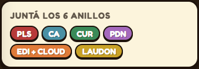

---

## 3. El tablero

- Es una **viborita en zigzag de 40 casillas** que vuelve a la Salida: las fichas
  **dan vueltas**, no hay casilla final.
- **Casilla de temática** (de color, con un anillo dibujado): sale una pregunta de esa temática.
- **Salida**: si caen justo ahí, **eligen ustedes la temática**. Además, al pasar o caer en la
  Salida **se recargan los comodines**.
- **Corral** (3 casillas con un corralito de madera): quien cae ahí **pierde el próximo turno**.
- Las temáticas con más preguntas tienen más casillas (por eso hay mucho LAUDON).
  El reparto cambia en cada partida nueva.

---

## 4. Cómo es un turno

1. **El equipo tira el dado físico** y dice el número en voz alta.
2. **El game master** toca ese número en el panel y aprieta **¡Mover!**.
3. La ficha avanza casilla por casilla.
4. Según dónde caen:
   - **Casilla de temática** → eligen **Fácil** o **Difícil**.
   - **Salida** → eligen la temática y después Fácil o Difícil.
   - **Corral** → no hay pregunta: pierden el próximo turno.
5. Aparece la pregunta en pantalla. Pueden pedir un **comodín** antes de responder.
6. El equipo dice su respuesta. El game master toca esa opción: **verde** = correcta,
   **rojo** = incorrecta (y se marca en verde cuál era la buena).
7. Se aplica el resultado (ver abajo).

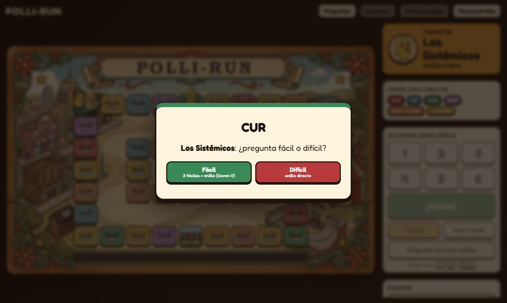

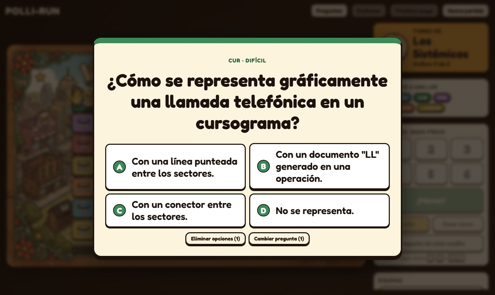

---

## 5. ¿Fácil o difícil?

| | Si responden **bien** | Si responden **mal** |
|---|---|---|
| **Difícil** | Ganan el **anillo** de esa temática al toque. | Pasa el turno. |
| **Fácil** | Suman **1 puntito** de esa temática. Con **3 puntitos** de la misma temática ganan el anillo. | Pasa el turno (los puntitos que ya tenían **no se pierden**). |

- Los puntitos se ven en la lista de equipos, al lado de cada temática (●●○ = llevan 2 de 3).
- Si ya tienen el anillo de esa temática, acertar no les da otro: les sirve para
  **seguir tirando** (y, si es difícil, para intentar un robo).

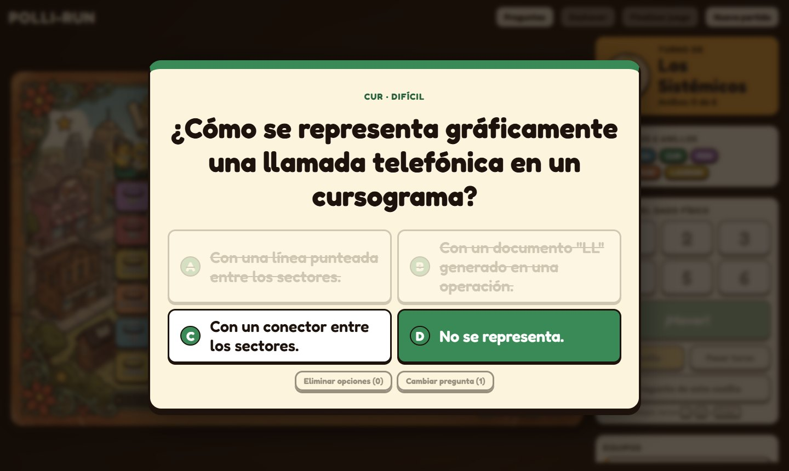

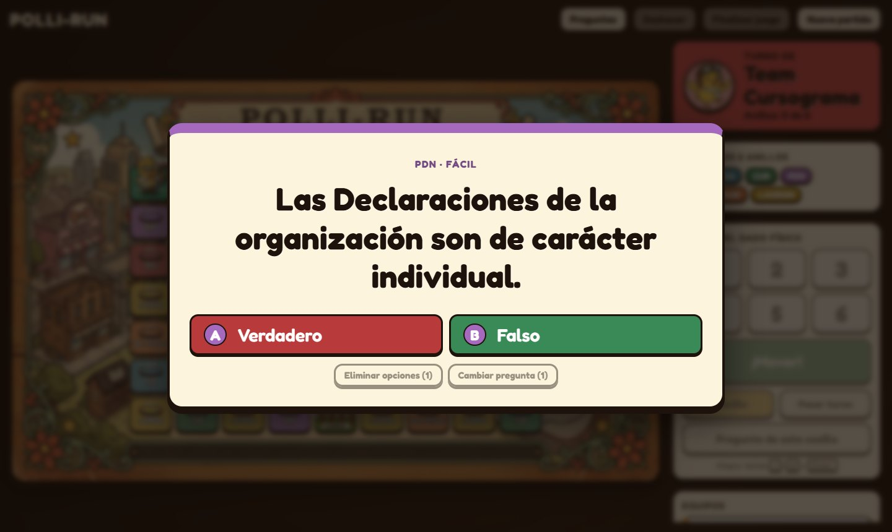

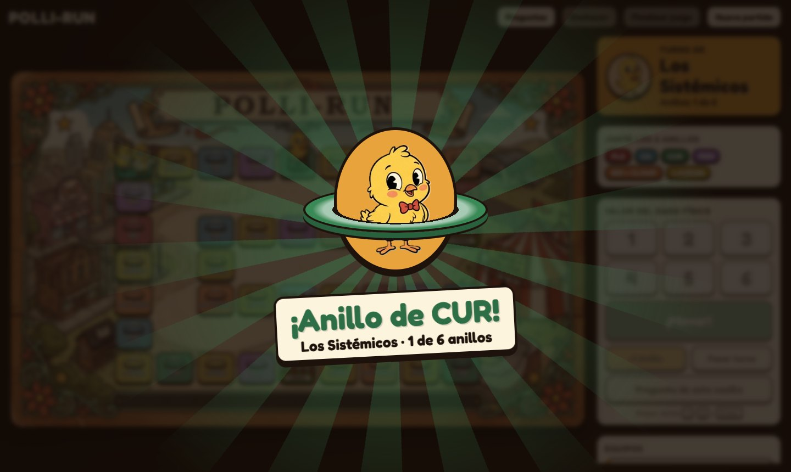

---

## 6. Si aciertan, siguen tirando

- **Responden bien y no ganan anillo** → **vuelven a tirar el dado** (el panel dice "Sigue tirando").
- **Ganan o roban un anillo** → festejo y **termina su turno**.
- **Responden mal** → pasa el turno al siguiente equipo.

Una fácil bien respondida, entonces, es "un puntito y otra tirada". Una difícil es "anillo,
pero se termina el turno". Ahí está la estrategia.

---

## 7. Robo de anillos

Si caen en **la misma casilla que otro equipo** y responden bien una pregunta **difícil**,
pueden **robarle un anillo**:

- Eligen **cualquiera de sus anillos que ustedes no tengan** (no tiene que ser de la temática
  de la casilla).
- El otro equipo **se queda sin ese anillo**.
- Pueden decidir **no robar**.
- En la misma jugada pueden ganar el anillo de la casilla **y además** robar otro.
- Robar **termina el turno**.

Antes de elegir la dificultad, la pantalla avisa si hay robo posible.

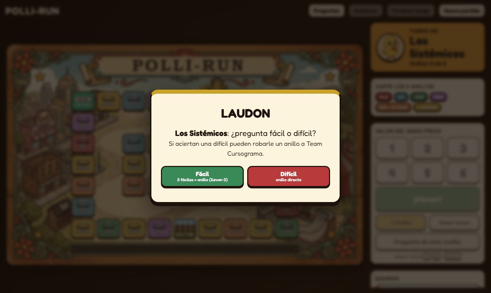

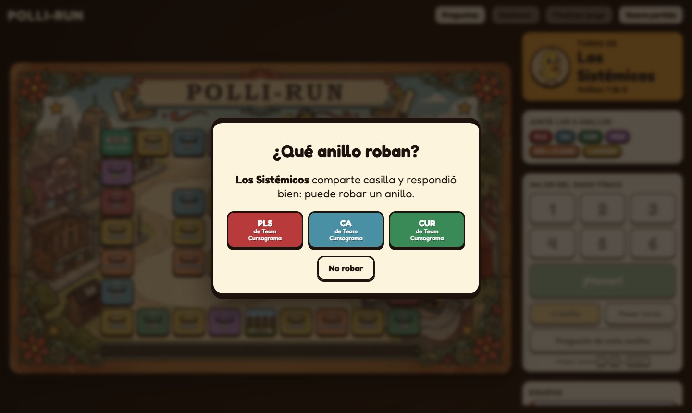

---

## 8. El corral

- Si caen en el **Corral** no hay pregunta: **pierden el próximo turno**.
- Su ficha se ve **gris** y en la lista de equipos dice **"En el corral"**.
- Cuando les toca, el juego salta automáticamente al equipo siguiente.

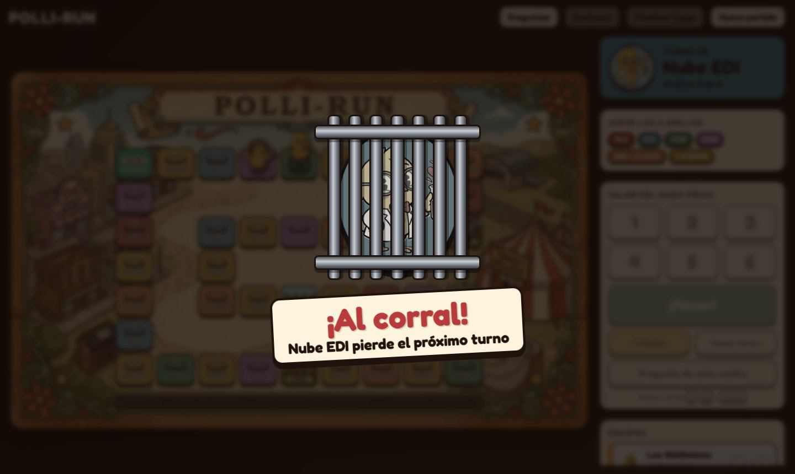

---

## 9. Comodines

Cada equipo arranca con **2 comodines**, uno de cada tipo. Se piden **dentro de la pregunta,
antes de responder**.

| Comodín | Qué hace | Cuándo no se puede |
|---|---|---|
| **Eliminar opciones** | Tacha opciones incorrectas: quedan solo **2** (la correcta y una incorrecta). | En preguntas de Verdadero/Falso o sin opciones. |
| **Cambiar pregunta** | Sale **otra pregunta** de la misma temática y dificultad. | Si no queda otra pregunta disponible. |

- Se pueden usar **los dos en la misma pregunta**.
- **Se recargan al pasar o caer en la Salida**, pero **no se acumulan**: vuelven a ser 1 y 1.
- En la lista de equipos se ven los comodines que les quedan (los usados aparecen tachados).

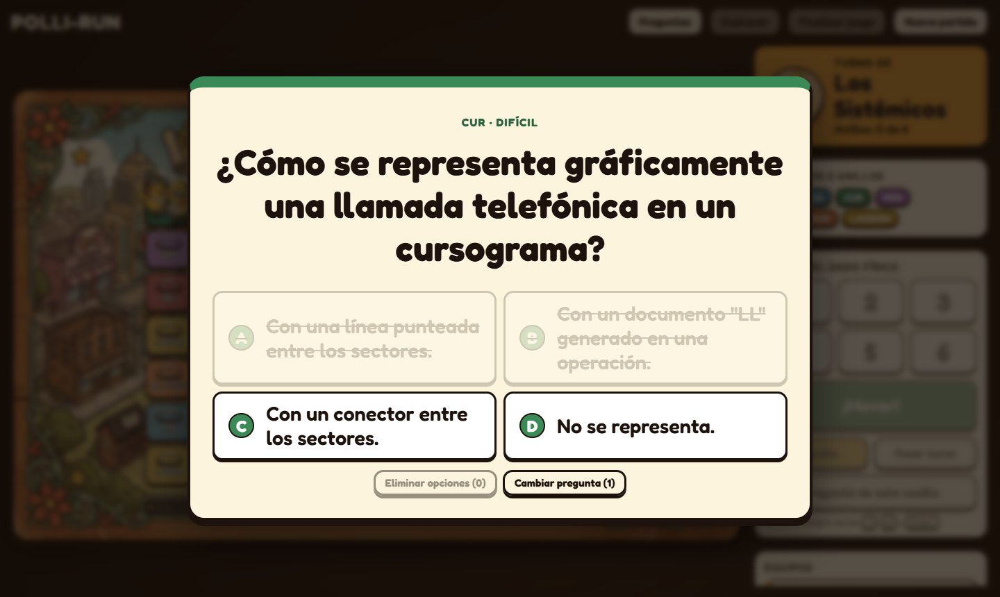

---

## 10. La Salida

- **Caer justo en la Salida** → eligen de qué temática quieren la pregunta.
- **Pasar o caer en la Salida** → comodines recargados.

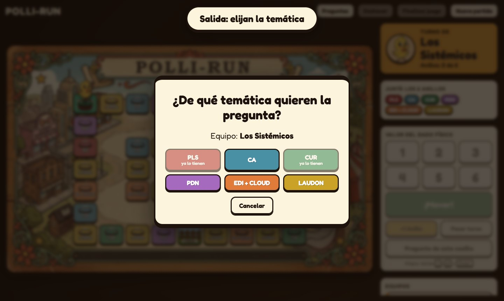

---

## 11. Las preguntas

- Las preguntas **acertadas no vuelven a salir**.
- Las **falladas** o las que se **cambiaron con el comodín** pueden volver a salir cuando se
  agoten las nuevas de esa temática.
- Si ya se acertaron **todas** las fáciles (o todas las difíciles) de una temática, esa
  dificultad queda desactivada: hay que elegir la otra o perder el turno.
- Algunas preguntas tienen **imagen** (por ejemplo, cursogramas en CUR).

---

## 12. ¿Cómo se gana?

- Cuando un equipo **junta los 6 anillos** se festeja, pero **el juego sigue**: esos anillos
  todavía se los pueden robar.
- El game master aprieta **Finalizar juego** y aparece el **podio** con la situación de ese momento.
- **Gana quien tiene más anillos.** Si empatan:
  1. gana el que **completó los 6 antes**;
  2. si sigue el empate, el que tiene **más fáciles acertadas** (puntitos).

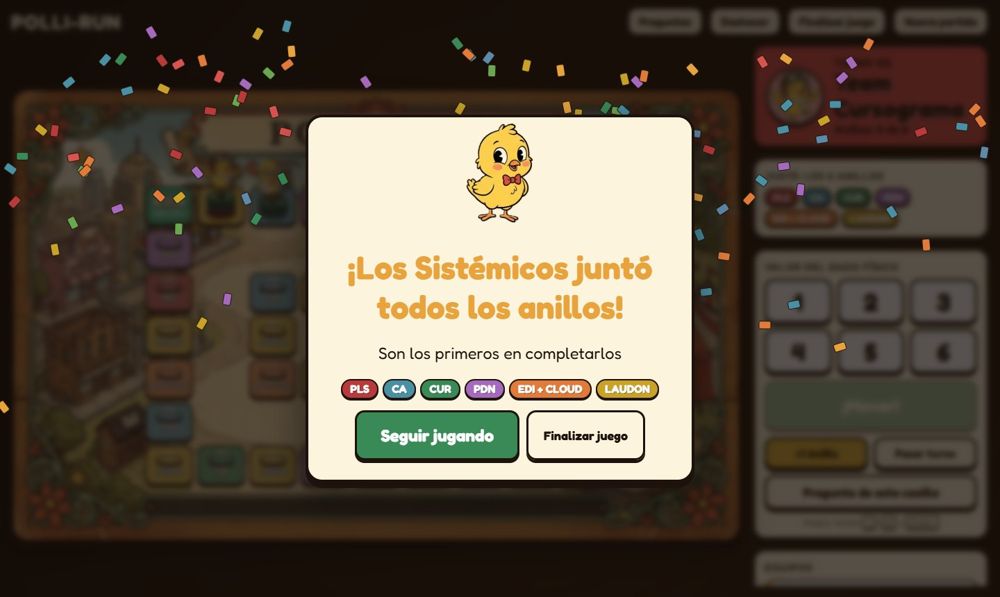

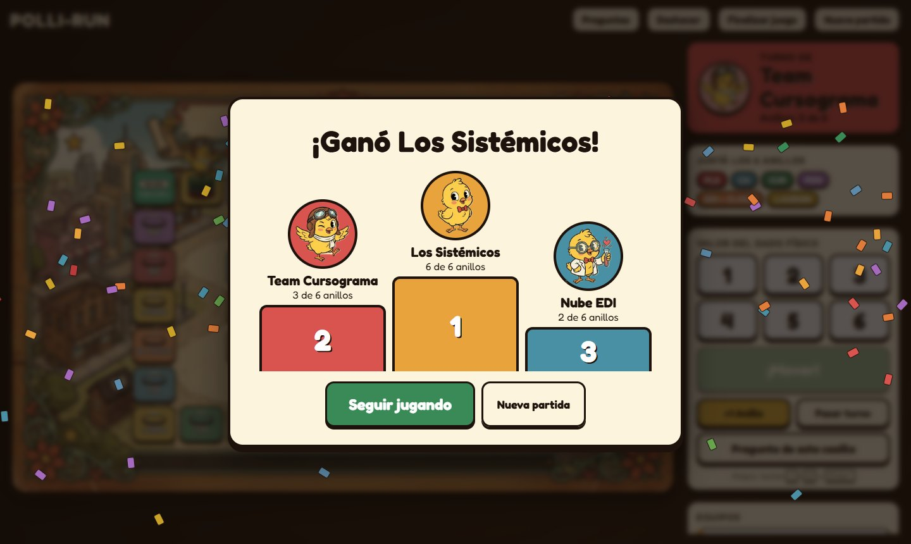

---

## 13. Resumen rápido

- Dado físico → el profe mueve → caen en una casilla.
- **Difícil bien = anillo** (termina el turno).
- **Fácil bien = puntito**; **3 puntitos = anillo**.
- **Bien sin anillo = siguen tirando.** **Mal = pasa el turno.**
- **Misma casilla que otro equipo + difícil bien = pueden robar un anillo.**
- **Corral = pierden el próximo turno.**
- **Comodines:** Eliminar opciones y Cambiar pregunta. **Se recargan en la Salida.**
- **Gana quien tiene más anillos** cuando el profe termina el juego.

---

# Guía para game masters (profes)

## Preparar la partida

1. Abrir **`index.html`** con doble clic (Chrome o Edge). No necesita internet.
2. El banco de preguntas de **SYP 2026** ya viene cargado (6 temáticas, 517 preguntas).
   Si hace falta otro, **Cargar CSV** (ver `LEEME.md`).
3. Registrar los equipos: nombre, ficha (personaje) y color. Mínimo 2; **Agregar equipo** para más.
4. **¡Empezar partida!**

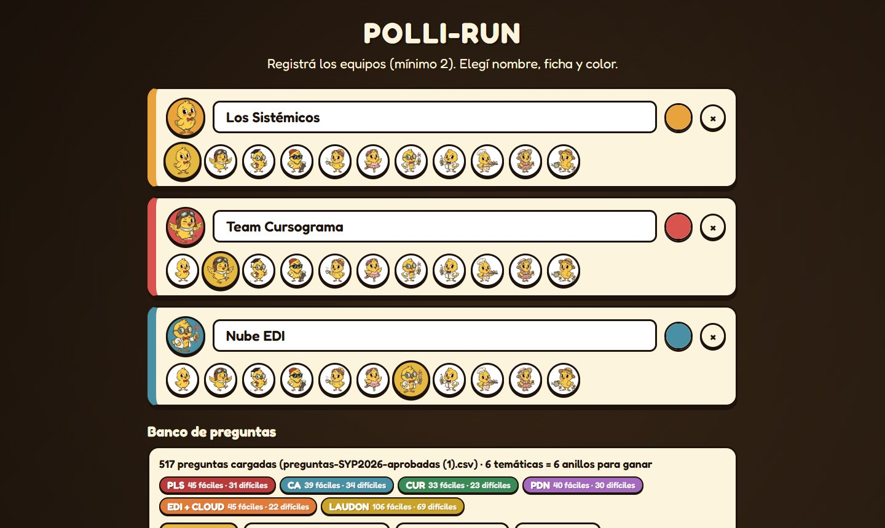

## El panel de control

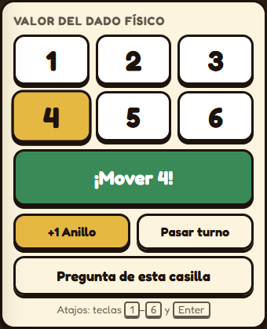

| Control | Para qué sirve |
|---|---|
| **1 – 6** | El número que salió en el dado físico (o las teclas `1`–`6`). |
| **¡Mover!** | Mueve la ficha (o tecla `Enter`). |
| **+1 Anillo** | Da un anillo a mano al equipo del turno (se elige la temática). |
| **Pasar turno** | Salta al equipo siguiente. |
| **Pregunta de esta casilla** | Vuelve a sacar una pregunta en la casilla donde está el equipo. |
| **+ / −** en la lista de equipos | Da un anillo / quita el último anillo de **ese** equipo. |
| **Deshacer** (arriba) | Revierte la última acción (hasta 30 pasos). |
| **Finalizar juego** (arriba) | Muestra el podio. Se puede **Seguir jugando** después. |
| **Nueva partida** (arriba) | Borra la partida actual y vuelve al registro. |
| **Preguntas** (arriba) | Cargar otro CSV en plena partida. |

Arriba a la derecha, la tarjeta de color muestra **de quién es el turno** (o "Sigue tirando").

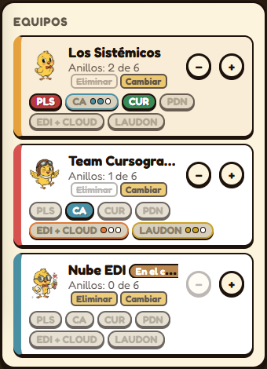

En la lista de equipos se ve, para cada uno: anillos ganados (a color), los que faltan
(apagados), los **puntitos** de fáciles, los **comodines** que quedan y si está **en el corral**.

## Al responder

- **Preguntas con opciones**: tocá la opción que **dijo el equipo**. El juego marca solo
  si es correcta y se cierra.
- **Preguntas sin opciones** (abiertas): aparecen los botones **Correcto / Incorrecto** y decidís vos.
- **Comodines**: si el equipo pide uno, tocalo **antes** de marcar la respuesta.

## Situaciones especiales

- **Tocaste mal un número o una opción** → **Deshacer**.
- **En la Salida**, la ventana de temática tiene **Cancelar**: si lo tocás, el equipo
  **pierde el turno**. Si fue sin querer, **Deshacer**.
- **Pregunta de esta casilla**: con este botón el turno **no pasa solo** si fallan;
  en ese caso tocá **Pasar turno**.
- **Se cerró la pestaña o se cortó la luz** → se guarda todo solo. Al volver a abrir aparece
  **Continuar partida guardada**.
- **Las escenas** (anillo, corral) se cierran solas o con un clic.

## Sugerencias para la dinámica

Esto no lo controla el juego; queda a criterio de ustedes:

- Que cada equipo tenga **un vocero** que diga la respuesta final.
- Marcar la opción recién cuando el equipo **confirma** ("¿última respuesta?").
- Poner un **tiempo** para responder (por ejemplo, 30 segundos para fáciles y 60 para difíciles).
- Avisar en voz alta cuando hay **robo posible** o un equipo cae en el **corral**, para que todos sigan el juego.
